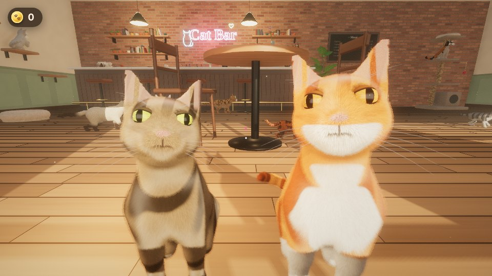
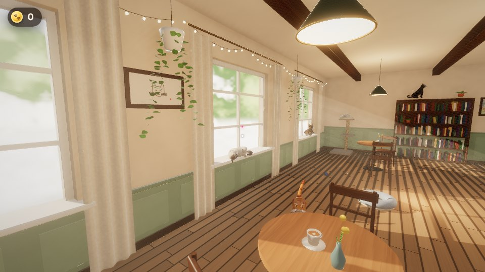

# Cat Bar

**Un caffè dei gatti in 3D che si esplora dal browser.**

Sei dentro il Cat Bar: il sole del pomeriggio entra dalle finestre, al bancone c'è l'insegna al neon e tredici gatti
giocano, dormono, si lavano e miagolano. Dal locale non si esce, ma puoi girare dove vuoi. Se tieni premuto il click
su un gatto lo accarezzi: fa le fusa e tu guadagni una moneta.

Non ci sono immagini, modelli 3D né file audio: tutto è generato dal codice. Il gioco è un **unico file HTML di 95 KB**.


## Come provarlo

1. Scarica [`index.html`](index.html).
2. Aprilo con **Chrome** o **Edge** su un computer.
3. Aspetta qualche secondo mentre il locale viene costruito, poi premi **Entra**.

Funziona anche offline. Serve un browser con **WebGPU**: se compare *"Il Cat Bar ha bisogno di WebGPU"*, aggiorna il
browser o usa Chrome / Edge.

## Cosa c'è dentro

- **13 gatti**, tutti diversi: europeo tigrato, siamese, calico, tuxedo, persiano, rosso tigrato, nero, certosino,
  Maine Coon, bengala, ragdoll e due gattini. Il pelo è vero pelo (decine di strati di peli), con mantelli tigrati,
  a macchie, colorpoint e tartarugati, occhi con la pupilla a fessura, baffi, naso e orecchie rosa
- **I gatti hanno una vita propria**: passeggiano, giocano con i gomitoli (che rotolano davvero, e puoi calciarli
  anche tu), dormono acciambellati nelle cucce al sole, si lavano, si stiracchiano, mangiano dalla ciotola, salgono sui
  tiragraffi, sul bancone, sulle mensole e sui davanzali, e a volte vengono da te a chiedere coccole
- **Coccole e monete**: guarda un gatto, tieni premuto il click e l'anello si riempie: il gatto chiude gli occhi, fa le
  fusa, escono dei cuoricini e ricevi una moneta. Ogni gatto può darti una moneta ogni 15 secondi. Le monete restano
  salvate nel browser
- **Il locale**: pavimento in rovere, muro di mattoni, bancone in marmo con macchina del caffè e torta, mensole con
  tazze e barattoli, insegna al neon "Cat Bar", lavagna con il menù, tavolini con cappuccini e fiori, divano di velluto
  con tappeto, libreria, piante, lampade a sospensione, lucine e una porta (chiusa: *"non far uscire i gatti!"*)
- **La luce**: il sole entra dalle tre finestre con raggi volumetrici e pulviscolo che brilla, ombre morbide,
  occlusione ambientale, bloom e tone mapping cinematografico
- **L'audio**, sintetizzato dal vivo: un piano elettrico lo-fi, il fruscio del vinile, i miagolii (ognuno diverso, più
  acuti per i gattini e posizionati nello spazio), le fusa e il tintinnio della moneta

| | |
|---|---|
|  |  |



## Comandi

| | Tastiera e mouse |
|---|---|
| Guardarsi intorno | Muovi il mouse |
| Camminare | `W` `A` `S` `D` (o le frecce) |
| Più veloce | Tieni premuto `Shift` |
| Accarezzare | Tieni premuto il click (o `E`) guardando un gatto |
| Accovacciarsi | Tieni premuto `C` (succede da solo quando accarezzi un gatto a terra) |
| Menù | `Esc` |
| Audio sì / no | `M` |
| Statistiche | `H` |
| Dettaglio | **Basso**, **Medio** o **Alto** nel menù (ricarica la pagina) |

**Sul touch screen:** trascina a sinistra per camminare, a destra per guardarti intorno, e tieni premuto il pulsante
con la zampa per accarezzare.

## Come funziona

- Lo stesso approccio di [Abyssal Garden](https://github.com/Noniv/abyssal-garden): **WebGPU** usato direttamente,
  nessun motore grafico né libreria 3D, niente file esterni, tutto in un file HTML.
- **I gatti** sono un'unica mesh scolpita all'avvio con funzioni di distanza (ellissoidi e coni arrotondati fusi
  insieme) e trasformata in triangoli con *surface nets*. Ha uno scheletro di 22 ossa (schiena, collo, testa, quattro
  zampe, sei vertebre della coda); le zampe sono posizionate con la cinematica inversa, e le pose (in piedi, seduto,
  a pagnotta, acciambellato, toelettatura, agguato, stiracchiamento) si fondono tra loro, con l'andatura della
  camminata sopra.
- **Il pelo** è disegnato a *shell*: la superficie del gatto viene ridisegnata decine di volte, ogni volta un po' più
  fuori e pettinata all'indietro, e lo shader la taglia in peli sempre più sottili verso la punta. Il mantello è una
  funzione della posizione sul corpo, quindi le strisce seguono il gatto quando si muove.
- **Il locale** è costruito con forme semplici (scatole arrotondate, solidi di rotazione, foglie) e materiali
  procedurali: venature del legno, mattoni, marmo, sisal, velluto, tappeto. Insegna, menù e quadri sono disegnati in
  un canvas al caricamento.
- Le ombre del sole sono calcolate una volta per la stanza e copiate a ogni fotogramma, con sopra solo gatti e
  gomitoli. La risoluzione si adatta da sola per restare fluida.

## Modificarlo

Il codice leggibile è nella cartella [`source`](source). Per ricostruire `index.html` serve [Node.js](https://nodejs.org) 18
o più recente:

```bash
cd source
npm install
npm run build
```

`npm run build:readable` scrive una versione non minificata, più comoda da leggere nel debugger del browser.

| File | Cosa contiene |
|---|---|
| [`source/src/world.js`](source/src/world.js) | Il locale: muri, finestre, bancone, mobili, piante, luci, i posti preferiti dai gatti, insegna e quadri. **Il punto da cui iniziare.** |
| [`source/src/cats.js`](source/src/cats.js) | I gatti: forma del corpo, scheletro, pose, camminata, comportamento, e la lista dei gatti con nome, razza e colori |
| [`source/src/shaders.js`](source/src/shaders.js) | L'aspetto: materiali, luce del sole, pelo e mantelli, occhi, raggi di luce, bloom e colore finale (WGSL) |
| [`source/src/main.js`](source/src/main.js) | Il renderer, la telecamera, i comandi, le coccole e le monete |
| [`source/src/audio.js`](source/src/audio.js) | Musica, miagolii, fusa e suono della moneta |
| [`source/src/quality.js`](source/src/quality.js) | I livelli di dettaglio |
| [`source/src/math.js`](source/src/math.js) | Numeri casuali, matrici e funzioni per costruire le mesh |
| [`source/template.html`](source/template.html) | La pagina: caricamento, menù, monete, mirino |

Qualche modifica facile per cominciare:

- **Aggiungere un gatto:** una riga nella lista `BREEDS` in `cats.js` (nome, razza, tipo di mantello, colori, occhi,
  lunghezza del pelo, taglia)
- **Colore del sole:** `SUNC` in `main.js`; la direzione è `SUN` in `world.js`
- **Quanto vale una coccola:** `PET_TIME` (durata) e `COOLDOWN` (attesa tra due monete dallo stesso gatto) in `main.js`

L'indirizzo `index.html?shot` disegna su una texture fuori schermo invece che sul canvas: serve per gli screenshot da
browser senza schermo.
