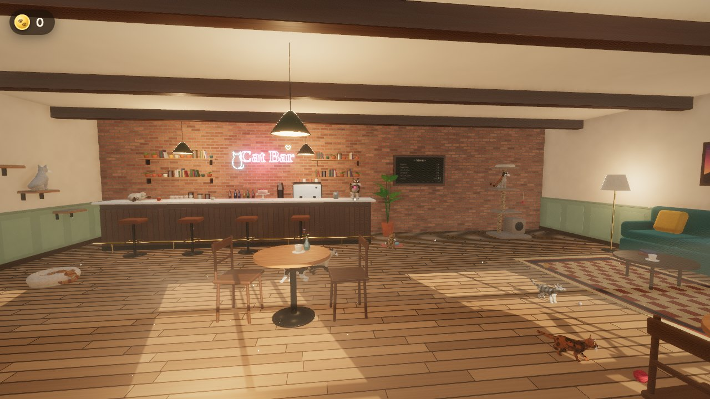
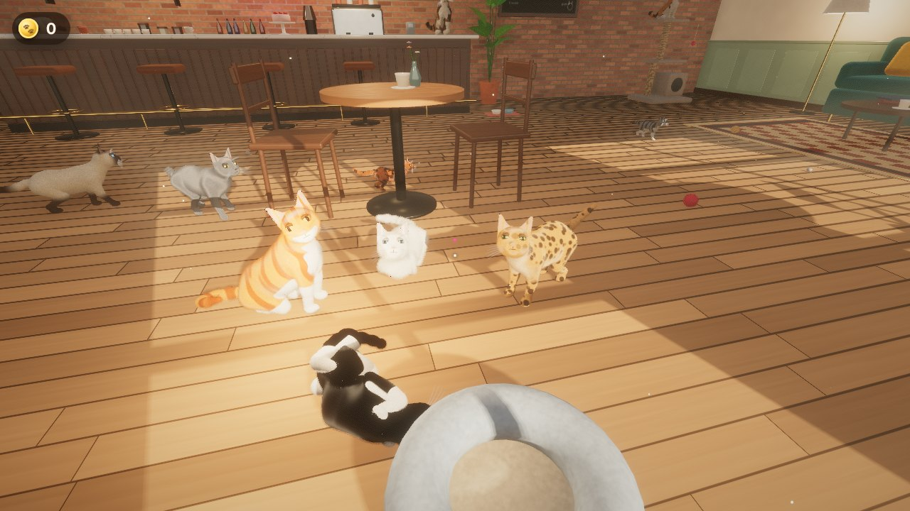

# Cat Bar

**Un caffè dei gatti in 3D che si esplora dal browser.**

Sei dentro il Cat Bar: il sole del pomeriggio entra dalle finestre, al bancone c'è l'insegna al neon e tredici gatti
giocano, dormono, si lavano e miagolano. Dal locale non si esce, ma puoi girare dove vuoi. Se tieni premuto il click
su un gatto lo accarezzi: fa le fusa e tu guadagni una moneta.

Non ci sono immagini, modelli 3D né file audio: tutto è generato dal codice. Il gioco è un **unico file HTML di circa 150 KB**.



## Come provarlo

1. Scarica [`index.html`](index.html).
2. Aprilo con **Chrome** o **Edge** su un computer.
3. Aspetta qualche secondo mentre il locale viene costruito, poi premi **Entra**.

Funziona anche offline. Serve un browser con **WebGPU**: se compare *"Il Cat Bar ha bisogno di WebGPU"*, aggiorna il
browser o usa Chrome / Edge.

## Cosa c'è dentro

- **13 gatti**, tutti diversi: europeo tigrato, siamese, calico, tuxedo, persiano, rosso tigrato, nero, certosino,
  Maine Coon, bengala, ragdoll e due gattini. Il pelo è vero pelo (decine di strati di peli), con mantelli tigrati,
  a macchie, colorpoint e tartarugati, occhi con la pupilla a fessura, baffi, naso e orecchie rosa
- **I gatti hanno una vita propria**: passeggiano, giocano con i gomitoli (che rotolano davvero, e puoi calciarli
  anche tu), dormono acciambellati nelle cucce al sole, si lavano, si stiracchiano, mangiano dalla ciotola, salgono sui
  tiragraffi, sul bancone, sulle mensole e sui davanzali, e a volte vengono da te a chiedere coccole
- **Coccole e monete**: guarda un gatto, tieni premuto il click e l'anello si riempie: il gatto chiude gli occhi, fa le
  fusa, escono dei cuoricini e ricevi una moneta. Ogni gatto può darti una moneta ogni 10 secondi. Le monete restano
  salvate nel browser
- **Il locale**: pavimento in rovere, muro di mattoni, bancone in marmo con macchina del caffè e torta, mensole con
  tazze e barattoli, insegna al neon "Cat Bar", lavagna con il menù, tavolini con cappuccini e fiori, divano di velluto
  con tappeto, libreria, piante, lampade a sospensione, lucine e una porta (chiusa: *"non far uscire i gatti!"*)
- **La luce**: il sole entra dalle tre finestre con raggi volumetrici e pulviscolo che brilla, ombre morbide,
  occlusione ambientale, bloom e tone mapping cinematografico
- **L'audio**, sintetizzato dal vivo: un piano elettrico lo-fi, il fruscio del vinile, i miagolii (ognuno diverso, più
  acuti per i gattini e posizionati nello spazio), le fusa e il tintinnio della moneta

### Novità

- **Cibo e cura**: ogni gatto ha fame, sete e benessere (le barre compaiono quando lo guardi). Le ciotole si svuotano
  davvero: riempile con **Crocchette** e **Acqua fresca**. Dai uno **Snack al tonno** con `F` al gatto che guardi.
  Un gatto felice dà **2 monete** a coccola invece di 1. La **Spazzola** rende le coccole più efficaci
- **Negozio** (`B`): gomitoli, topolino a carica, scatola di cartone (ci si infilano dentro), cuscino all'erba gatta
  (rotolate a pancia in su e corse pazze) e **puntatore laser** (`L`: tutti all'inseguimento del puntino)
- **Pacchetti di carte**: il Pacchetto Classico e il Pacchetto di Natale contengono 19 **gatti speciali** in quattro
  rarità: Babbo Miao col cappello, Rudolph con corna e naso rosso, Strega, Panda, Bastoncino di zucchero, Fiocco di
  Neve, Zucca Lanterna, Neon, Arcobaleno, e i leggendari Galassia, Re Mida, Angelo e Lava, con pelo luminoso e
  scintillante. Ogni gatto trovato entra dalla porta e resta nel locale; i doppioni restituiscono monete
- **Coccole vive**: una mano accarezza il gatto, che reagisce a modo suo: strofina la testa, impasta con le zampe,
  inarca la schiena con la coda dritta o si rotola a pancia in su
- **Lingua**: italiano se il browser è in italiano, altrimenti inglese
- **Mini giochi**: ogni tanto un gatto mostra un 🎲 sopra la testa. Avvicinati e premi `G` (sul telefono tocca
  l'icona): ti sfida a **Tris** o a **Pong col gomitolo** (la sua zampa contro la tua mano). Vincendo prendi monete e
  a volte un accessorio che il negozio non vende (occhiali da sole, aureola)
- **Vestiti** (tasto `V` guardando un gatto, o la scheda nel negozio): cappellini (berretto di lana, cilindro, fiocco,
  coroncina di fiori, Natale, elfo, strega, renna, corona), collanine (perle, medaglietta a cuore, campanellino,
  papillon, bandana, sciarpa) e vestitini (maglioncino, mantello da supereroe, tutù). Uno per testa, viso, collo e corpo
- **Grafica**: antialiasing temporale, luce che rimbalza dalle chiazze di sole, riflessi sul pavimento, sfocatura di
  profondità quando guardi un gatto, pelo più fitto
- **Telefono**: tocca un gatto e ci vai da solo ad accarezzarlo; tocca il pavimento per camminare lì; trascina per
  guardarti intorno; joystick fisso in basso a sinistra; pulsanti per snack, laser e vestiti; negozio a tutto schermo;
  funziona anche in verticale. I telefoni partono col dettaglio Basso per restare fluidi
- **Amicizia**: ogni gatto ha da 0 a 5 cuori (♥♡♡♡♡ accanto al nome). Coccole, snack, mini giochi e vestiti li fanno
  crescere. Con 2 cuori ti segue, con 3 ti porta dei regali (monete), con 4 ogni coccola vale una moneta in più
- **Giorno e notte**: una giornata dura 12 minuti; il sole attraversa le finestre, al tramonto la luce è arancione, di
  notte fuori ci sono le stelle e dentro le lampade. L'ora è accanto alle monete
- **Meteo**: pioggia con le gocce fuori dalle finestre e il suono sui vetri, neve con gli alberi imbiancati (più spesso
  in inverno). Col brutto tempo i raggi di sole spariscono e la luce diventa morbida
- **Modalità foto** (tasto `P` o 📷): nasconde l'interfaccia, cinque filtri (normale, caldo, bianco e nero, vintage,
  sogno) e uno scatto da salvare
- **Momenti tra gatti**: due gatti si leccano a vicenda, fanno la lotta per gioco o dormono insieme nella stessa cuccia
- **Clienti** (dalle 7:30 alle 21): entrano, si siedono a un tavolino e ordinano (espresso, cappuccino, tè, cioccolata).
  Vai alla macchina del caffè dietro il bancone (`R` o il pulsante), preparalo fermando il cursore nella zona verde e
  portalo al cliente (`R` o tocca la sua bolla). Più è buono e più i gatti sono felici, più ti pagano
- **Livello del locale** (⭐ accanto alle monete): clienti, coccole e mini giochi danno esperienza. Al livello 2 si
  sblocca l'arredamento, al 3 due clienti alla volta e le adozioni, poi mance più ricche e tre clienti
- **Arredamento** (scheda 🏠 del negozio): cucce, igloo, trasportino, tiragraffi, poltrona, piante e tappeti. Scegli il punto
  guardando il pavimento; i gatti li usano per dormire e salire in alto
- **Adozioni**: un cliente contento può chiedere di adottare un gatto che ti vuole bene. Se accetti, il cliente posa un
  trasportino, il gatto ci entra e lui lo porta via, ricevi 60 monete, dopo un po' arriva una lettera e un nuovo trovatello entra nel locale.
  I gatti speciali delle carte non vengono mai adottati
- **Salvataggio**: il gioco ricorda da solo nel browser monete, livello, gatti, vestiti, mobili, amicizie, e anche
  l'ora del giorno, il meteo e dove ti trovavi. Dal menù: **Esporta** (un codice da copiare), **Importa** (per
  portare il salvataggio su un altro dispositivo) e **Ricomincia** (azzera tutto, con conferma)
- La versione del gioco è scritta in basso nella schermata iniziale

| | |
|---|---|
|  |  |


## Comandi

| | Tastiera e mouse |
|---|---|
| Guardarsi intorno | Muovi il mouse |
| Camminare | `W` `A` `S` `D` (o le frecce) |
| Più veloce | Tieni premuto `Shift` |
| Accarezzare | Tieni premuto il click (o `E`) guardando un gatto |
| Negozio | `B` |
| Dare uno snack | `F` guardando un gatto |
| Puntatore laser | `L` (dopo averlo comprato) |
| Vestire un gatto | `V` guardandolo |
| Mini gioco | `G` vicino al gatto col 🎲 |
| Modalità foto | `P` (spazio per scattare) |
| Preparare / servire | `R` vicino alla macchina del caffè o al cliente |
| Accovacciarsi | Tieni premuto `C` (succede da solo quando accarezzi un gatto a terra) |
| Menù | `Esc` |
| Audio sì / no | `M` |
| Statistiche | `H` |
| Dettaglio | **Basso**, **Medio** o **Alto** nel menù (ricarica la pagina) |

**Sul touch screen:** tocca un gatto per andare ad accarezzarlo, tocca il pavimento per camminare, trascina per
guardarti intorno, oppure usa il joystick in basso a sinistra.

## Come funziona

- Lo stesso approccio di [Abyssal Garden](https://github.com/Noniv/abyssal-garden): **WebGPU** usato direttamente,
  nessun motore grafico né libreria 3D, niente file esterni, tutto in un file HTML.
- **I gatti** sono un'unica mesh scolpita all'avvio con funzioni di distanza (ellissoidi e coni arrotondati fusi
  insieme) e trasformata in triangoli con *surface nets*. Ha uno scheletro di 22 ossa (schiena, collo, testa, quattro
  zampe, sei vertebre della coda); le zampe sono posizionate con la cinematica inversa, e le pose (in piedi, seduto,
  a pagnotta, acciambellato, toelettatura, agguato, stiracchiamento) si fondono tra loro, con l'andatura della
  camminata sopra.
- **Il pelo** è disegnato a *shell*: la superficie del gatto viene ridisegnata decine di volte, ogni volta un po' più
  fuori e pettinata all'indietro, e lo shader la taglia in peli sempre più sottili verso la punta. Il mantello è una
  funzione della posizione sul corpo, quindi le strisce seguono il gatto quando si muove.
- **Il locale** è costruito con forme semplici (scatole arrotondate, solidi di rotazione, foglie) e materiali
  procedurali: venature del legno, mattoni, marmo, sisal, velluto, tappeto. Insegna, menù e quadri sono disegnati in
  un canvas al caricamento.
- Le ombre del sole sono calcolate una volta per la stanza e copiate a ogni fotogramma, con sopra solo gatti e
  gomitoli. La risoluzione si adatta da sola per restare fluida.

## Modificarlo

Il codice leggibile è nella cartella [`source`](source). Per ricostruire `index.html` serve [Node.js](https://nodejs.org) 18
o più recente:

```bash
cd source
npm install
npm run build
```

`npm run build:readable` scrive una versione non minificata, più comoda da leggere nel debugger del browser.

| File | Cosa contiene |
|---|---|
| [`source/src/world.js`](source/src/world.js) | Il locale: muri, finestre, bancone, mobili, piante, luci, i posti preferiti dai gatti, insegna e quadri. **Il punto da cui iniziare.** |
| [`source/src/cats.js`](source/src/cats.js) | I gatti: forma del corpo, scheletro, pose, camminata, comportamento, e la lista dei gatti con nome, razza e colori |
| [`source/src/shaders.js`](source/src/shaders.js) | L'aspetto: materiali, luce del sole, pelo e mantelli, occhi, raggi di luce, bloom e colore finale (WGSL) |
| [`source/src/main.js`](source/src/main.js) | Il renderer, la telecamera, i comandi, le coccole e le monete |
| [`source/src/shop.js`](source/src/shop.js) | Negozio, cibo e cura, pacchetti di carte, collezione |
| [`source/src/games.js`](source/src/games.js) | Mini giochi: Tris e Pong col gomitolo |
| [`source/src/life.js`](source/src/life.js) | Giorno e notte, meteo, amicizia, modalità foto |
| [`source/src/cafe.js`](source/src/cafe.js) | Clienti e macchina del caffè, livello del locale, adozioni, arredamento |
| [`source/src/audio.js`](source/src/audio.js) | Musica, miagolii, fusa e suono della moneta |
| [`source/src/quality.js`](source/src/quality.js) | I livelli di dettaglio |
| [`source/src/math.js`](source/src/math.js) | Numeri casuali, matrici e funzioni per costruire le mesh |
| [`source/template.html`](source/template.html) | La pagina: caricamento, menù, monete, mirino |

Qualche modifica facile per cominciare:

- **Aggiungere un gatto:** una riga nella lista `BREEDS` in `cats.js` (nome, razza, tipo di mantello, colori, occhi,
  lunghezza del pelo, taglia)
- **Colore del sole:** `SUNC` in `main.js`; la direzione è `SUN` in `world.js`
- **Quanto vale una coccola:** `PET_TIME` (durata) e `COOLDOWN` (attesa tra due monete dallo stesso gatto) in `main.js`

L'indirizzo `index.html?shot` disegna su una texture fuori schermo invece che sul canvas: serve per gli screenshot da
browser senza schermo.
